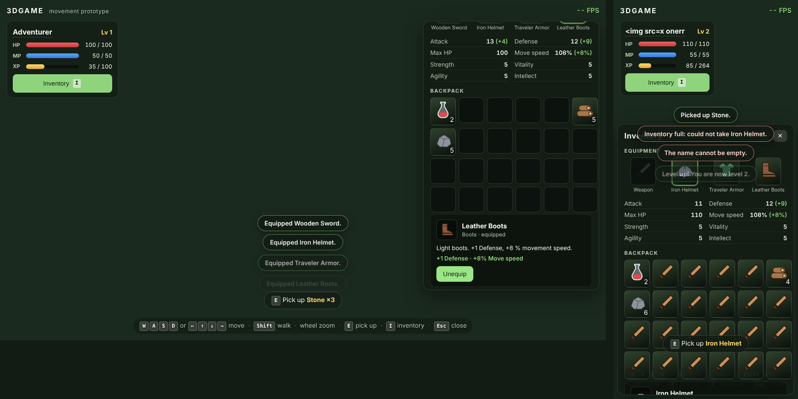

# Character, inventory, equipment and pickups

## How to try it

`npm run dev`, then walk around the spawn clearing (all ten pickups lie within ~6 m of the start):

| Do | Result |
|---|---|
| Stand next to an item | prompt `E  Pick up Health Potion` appears at the bottom |
| `E` | item goes into the backpack (toast); if it does not fit, it stays on the ground (toast "Inventory full") |
| `I` or the **Inventory** button | open/close the panel (`Esc`/✕ closes) |
| Click a slot | details, then **Use** (potion), **Equip** (gear), **Unequip** (worn item), **Drop 1 / Drop all** |
| Click the name | rename |

Start state: *Adventurer*, level 1, HP 70/100 (so the potion can be tested at once), MP 50/50, XP 35/100.
Console helpers: `__game.dev.damage(30)`, `.heal(n)`, `.gainXp(500)`, `.fillInventory()` (fills every free slot with swords, to test "full"), `.state`.

## Rules (all covered by `tests/game.test.ts`)

* **One source of truth:** `PlayerState` (profile + `Inventory` + `Equipment`). The UI renders it and calls its actions; nothing is cached in the DOM.
* **Items:** defined once in `game/items.ts` (id, name, type, description, `maxStack`, bonuses, placeholder icon). Health Potion (heals 40, stacks to 10), Wooden Sword (+4 attack), Iron Helmet (+3 defense), Traveler Armor (+5 defense), Leather Boots (+1 defense, +8 % move speed), Wood and Stone (stack to 50).
* **Inventory:** 24 slots; adding is all-or-nothing (a stack that only half fits is refused and nothing changes); a stack that fits into an existing partial stack is accepted even when no slot is free.
* **Potion:** heals and is consumed; at full HP it is refused, **not** consumed, and the Use button is disabled.
* **Equipment:** an item only fits the slot of its type; equipping moves it out of the bag; equipping over a worn item swaps it into the freed bag slot; unequipping needs a free bag slot, otherwise nothing changes (button disabled + message). Equipped items cannot be dropped.
* **Stats are derived, never accumulated:** `deriveStats(profile, equippedItems)` is recomputed from scratch on every change, so equipping/unequipping any number of times (tested: 200 changes) always returns to the exact base values. HP/MP are clamped to `[0, max]` after every change.
* **Drop / pickup:** a dropped item becomes exactly one world pickup (1.1 m in front of the player, kept inside the map) and picking it up returns exactly that amount; `E` key repeat does not pick up several items.
* **Typing guard:** `InputController` ignores movement keys and shortcuts while an `<input>`/`<textarea>`/`<select>`/contenteditable has focus (the rename field). Ctrl/Meta/Alt combinations are left to the browser.

## Movement speed bonus (opt-in)

Boots carry `moveSpeed: 0.08`. It is only applied if `character.equipmentSpeedBonus` is `true` in `src/config.ts` (it is, explicitly); set it to `false` and movement is exactly the configured speeds whatever is worn. `MovementModel.speedScale` (default 1) only scales the target walk/run speed; damping, turning, collision and the animation blending are untouched (running faster than `runSpeed` just keeps the run clip at full weight with the gait cadence tied to ground speed). Total bonus is clamped to +25 %.

## Not done / limits

* No persistence: state lives for the session (no localStorage, backend or accounts, as requested). Reloading the page resets everything.
* No combat, so nothing damages the player; HP/XP change only through the console helpers and the potion. Mana is displayed but nothing uses it yet.
* Pickups are placeholder shapes (cylinder, box, polyhedron…), not Kenney models; inventory icons are simple inline SVG shapes.
* The Babylon-side parts (`PickupView`, wiring in `Game`) are type-checked only against stubs and have not been run (npm registry blocked in the sandbox).
