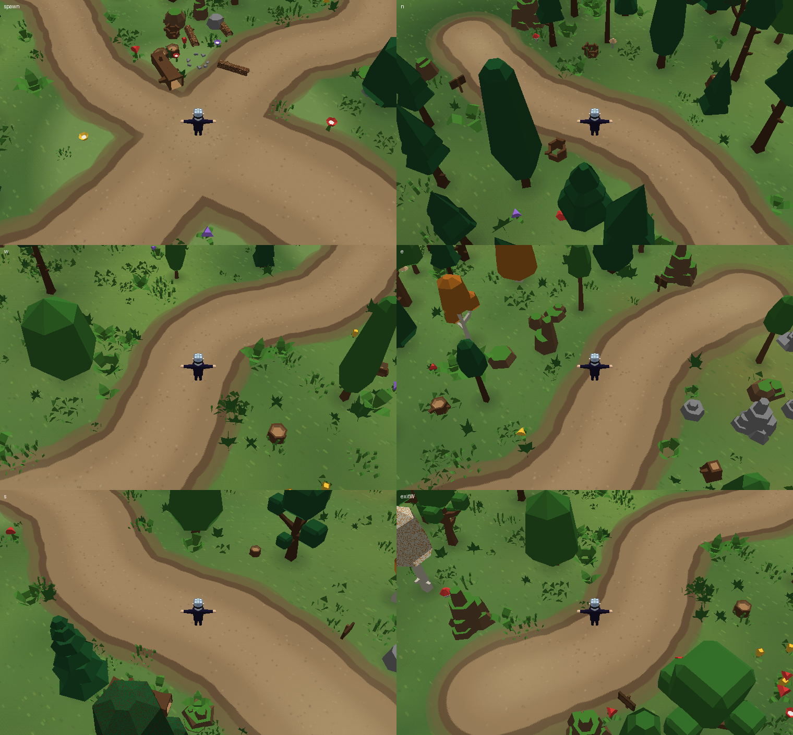
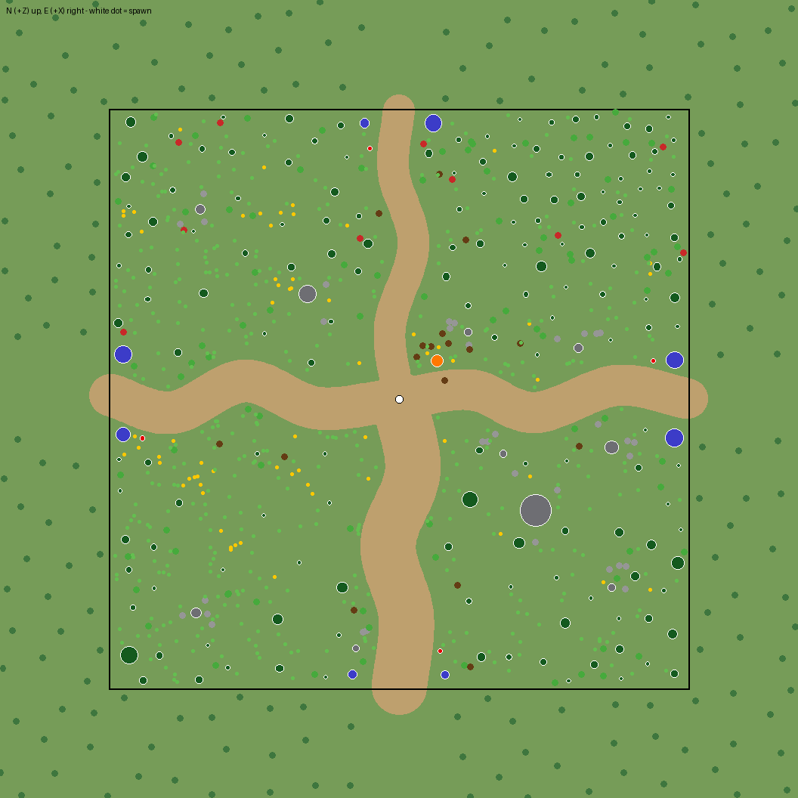

# First playable forest map

*Offline software render (`tools/map_preview.py`) from the real GLB files with the game's camera angles and the 1.94 m hero for scale. It is not the Babylon renderer: no shadows, no fog.*

*`tools/layout_plot.py`: paths, solid colliders (white outline) and decoration. North (+Z) is up, east (+X) right.*

## Map

* 64 × 64 m, flat (`y = 0`), spawn at the centre of a 7.5 m open clearing with a campfire and log seats.
* Four paths from the clearing to the edges (`MapConfiguration.ts`): **south** 6.0 m wide (main road), **east** 4.4 m, **west** 4.6 m, **north** 3.4 m.
* Regions: north = dense dark conifer forest; east = mixed trees, autumn leaves, rock clusters beside the path; west = light broadleaf and open meadow with flowers; south = moderate forest along the main road; the four corners are denser. Density is a smooth function of position (variable-radius Poisson sampling), not hard borders.
* Exits are **placeholders**: each path ends at the map edge between two tall marker rocks, with a sign beside the path. Nothing happens when you reach them; the boundary stops the player.
* Outside the square: ~180 decorative-only trees (no collision) and a huge plain ground plane, so no edge of the world is ever visible.

## Models (real Kenney Nature Kit, `assets/kenney_nature-kit/Models/GLTF format/`)

148 models are catalogued and verified, **106 of them are placed** in the current layout and only those are downloaded at runtime (see `src/world/forest/NatureCatalog.ts`, generated by `npm run catalog` from the files themselves): 8 + 2 + 6 + 4 conifers and cones, broadleaf trees in default/dark/fall variants, 6 + 10 large/tall rocks and 6 + 10 stones, 20 small rocks, 6 bushes, 6 grasses/plants, 9 flowers, 6 mushrooms, logs, stumps, campfire, sign. Nothing is referenced by guess: the generator fails if a file is missing, is not self-contained, or has external URIs; a test re-checks size and SHA-1 and that the served copy in `public/models/nature/` is byte-identical.

Colours: the kit has no textures, only flat colours per material, and its authored palette is stylised teal and orange (see `Preview.png` in the kit). The default `forest` palette replaces the flat colour per **material name** with natural greens/browns (`NaturePalette.ts`); the geometry is untouched. `?palette=kenney` shows the authored colours.

Scale: the models are tiny (a tree is ~1.5 units), so they are scaled per category (trees ×3.5–3.6 ≈ 5–7 m, large rocks ×3.4, etc.) against the 1.94 m hero.

## Collision

* Only **tree trunks** (one circle per tree, radius = 95 % of the measured trunk base radius × scale), **large rocks** (1–2 circles from the footprint), the **campfire**, **signs** and the exit marker rocks are solid. Canopies, bushes, grass, flowers, mushrooms, logs, stumps and small rocks never block.
* The map boundary is an axis-aligned rectangle (`CollisionWorld.setRectBounds`); contacts remove only the velocity component into the obstacle, so the player slides along trunks and walls.
* No trapping: trees and rocks keep ≥ 1.6 m between their edges and no two solids (including signs, camp and marker rocks) are closer than 1.1 m (the player is 0.76 m wide); paths and the clearing are free by construction; tests flood-fill the walkable area with the real player radius.

## Performance

* Each model file is downloaded and parsed once, baked into one vertex-coloured mesh, and every placement after the first is an `InstancedMesh` (995 objects → at most 106 draw calls plus the shadow pass); one shared frozen material; world matrices frozen; nothing is created or updated per frame.
* Only trees, large rocks and similar solids cast shadows; the shadow map covers the playable square only.
* Ground = two quads (one painted 2048² texture, one plain plane). The painter runs once (~0.5 s in Chromium).
* Layout generation ≈ 0.3 s, deterministic from `seed`.

## Known limitations

* Tall canopies can hide the hero when a tree stands between camera and player (no occlusion fade yet).
* Exits do nothing. No terrain height. No collision for logs/stumps (by design).
* The Babylon-side code (loader, instancing, shadow extents, painted texture orientation, glTF handedness auto-correction) has not been executed; see README "Verification status".
